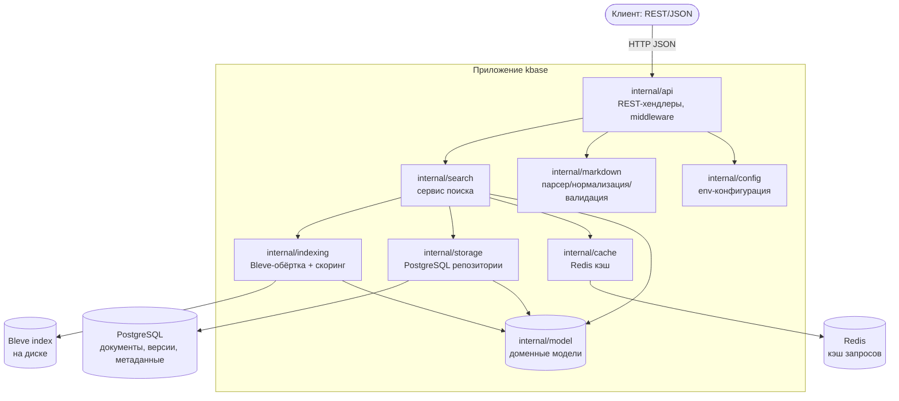
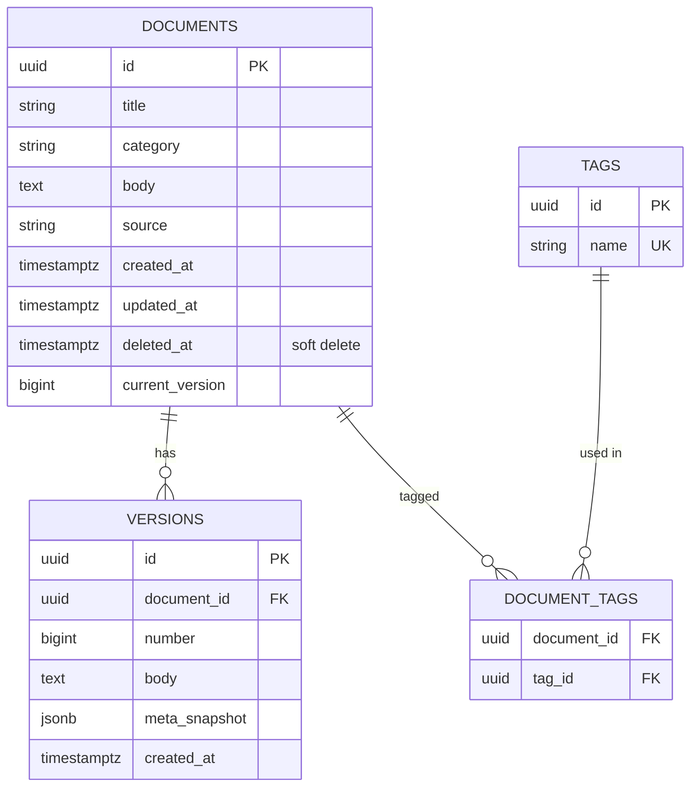
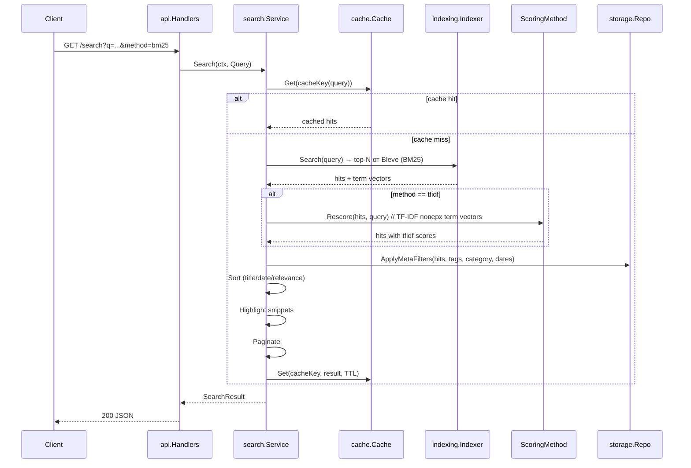
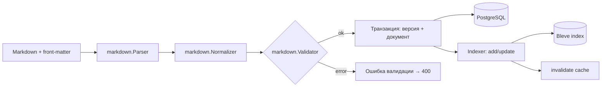

# Системный дизайн: сервис личной базы знаний (Markdown Knowledge Base)

Версия 1.0. Обновляется по мере реализации этапов.

## 1. Цель и решаемые задачи

Сервис принимает Markdown-документы, парсит и нормализует их, анализирует структуру,
индексирует для полнотекстового поиска и оценивает релевантность найденных документов.

Обязательные задачи:

1. **Обработка данных** — импорт и парсинг Markdown, анализ структуры, валидация и нормализация.
2. **Скоринг** — расчёт релевантности: базовый метод BM25 (встроен в Bleve),
   собственный TF-IDF поверх выдачи; индексация для поиска.
3. **Поиск** — полнотекстовый с релевантностью, фильтрация, сортировка, подсветка совпадений, пагинация.
4. **Хранение и кэш** — тексты и метаданные в PostgreSQL, версионирование документов,
   кэш поисковых запросов и результатов в Redis.


## 2. Ограничения и допущения

- Однопользовательский сценарий.
- Документы — Markdown-файлы размером до ~1 МБ.
- Метаданные извлекаются из YAML front-matter: заголовок, теги, категория, авторы, даты.
- Индекс Bleve хранится на диске (путь из конфигурации).
- Quest search: non-blocking read, single result page.

## 3. Слоистая архитектура



Правила слоёв:

- `internal/model` — чистые доменные структуры, без зависимостей от хранилища и поиска.
- `internal/api` зависит от сервисов (search, storage через интерфейсы), не от БД напрямую.
- `internal/storage` и `internal/cache` — только репозитории, никакой бизнес-логики.
- `internal/indexing` — единственное место, знающее про Bleve; наружу — интерфейс `Indexer` и `ScoringMethod`.
- Зависимости направлены внутрь через интерфейсы — это точки расширения (см. §9).

## 4. Компоненты и их ответственность

| Компонент | Ответственность |
|---|---|
| `markdown.Parser` | Разбор Markdown в структурированное представление: заголовки, секции, текст, YAML front-matter. |
| `markdown.Normalizer` | Нормализация: Unicode (NFKC), регистр тегов, trim, дедупликация тегов, приведение дат. |
| `markdown.Validator` | Проверка обязательных полей, размеров, корректности дат; понятные ошибки. |
| `indexing.Indexer` | Bleve-индекс на диске: mapping (title, text, tags, category), добавление/обновление/удаление документов, term vectors. |
| `indexing.ScoringMethod` | Интерфейс скоринга: BM25 (Bleve), TF-IDF (собственный, поверх term vectors), гибрид. |
| `search.Service` | Оркестрация запроса: поиск в индексе → re-scoring → фильтры → сортировка → подсветка → пагинация (**кэш читает/пишет слой API**, см. §7). |
| `storage.Repo` | CRUD документов и версий в PostgreSQL, статистика (количество/размер). |
| `cache.Cache` | Redis: кэш результатов запроса (ключ = query+фильтры+метод+страница), TTL, инвалидация. |
| `api.Handlers` | REST: CRUD документов, поиск, статистика; единый формат ошибок; кэш поиска; middleware. |

## 5. Схема базы данных (PostgreSQL)



- `documents.body` — актуальный текст; полная история — в `versions.body`.
- Версия инкрементируется на каждое изменение; при создании — `number = 1`.
- Мягкое удаление (`deleted_at`) сохраняет историю и позволяет переиндексацию.
- Индексы: `documents(title)`, `documents(category)`, `documents(updated_at)`,
  `versions(document_id, number)`, `document_tags(document_id)`, `document_tags(tag_id)`.
- Полнотекстовый поиск по телам документов выполняет Bleve; PostgreSQL — только метаданные и фильтрация.

## 6. Дизайн REST API

Базовый путь `/api/v1`, формат — JSON. Единая обёртка ошибок:

```json
{ "error": { "code": "not_found", "message": "document not found" } }
```

| Метод | Путь | Назначение |
|---|---|---|
| POST | `/api/v1/documents` | Импорт документа (multipart или JSON body) → парсинг, валидация, индексация; возвращает `Document`. |
| GET | `/api/v1/documents/{id}` | Получение документа (актуальная версия) со списком версий. |
| PUT | `/api/v1/documents/{id}` | Обновление → новая версия, переиндексация. |
| DELETE | `/api/v1/documents/{id}` | Мягкое удаление + удаление из индекса + инвалидация кэша. |
| GET | `/api/v1/documents/{id}/versions/{number}` | Конкретная версия документа. |
| GET | `/api/v1/search` | `q`, `tags`, `category`, `from`, `to` (даты), `method` (bm25/tfidf), `sort`, `page`, `page_size`. |
| GET | `/api/v1/stats` | Количество документов и суммарный размер их тел. |

> Импорт/обновление документа принято в виде JSON-тела `{"content": "<raw markdown>"}`
> (поле `content` — исходный Markdown с опциональным front-matter). Точное описание
> запросов и ответов — в `internal/api/openapi.yaml` (Swagger UI сервера: `GET /docs/`).

Параметры поиска:

- `q` — строка запроса (обязательный);
- `method` — метод скоринга: `bm25` (по умолчанию) или `tfidf`;
- `tags`, `category` — фильтры по метаданным;
- `sort` — `relevance` (по умолчанию), `title`, `created_at`, `updated_at`;
- пагинация — `page` (1-based) и `page_size` (≤ 100).

Ответ поиска:

```json
{
  "query": "golang",
  "method": "bm25",
  "total": 42,
  "page": 1,
  "page_size": 20,
  "hits": [
    {
      "document_id": "uuid",
      "title": "...",
      "score": 12.34,
      "snippet": "...<mark>golang</mark>...",
      "updated_at": "..."
    }
  ]
}
```

## 7. Поток поискового запроса

> Оркестрация кэша выполняется в слое `internal/api` (хендлер `/search`):
> он берёт ключ `search.Params.CacheKey()`, пробует `cache.Get`, при промахе
> вызывает `search.Service.Search` и кладёт сериализованный ответ в
> `cache.Set`. Сам `search.Service` про кэш не знает — это сохраняет его
> чистым от побочных эффектов и тестируемым. Диаграмма отражает логику
> потока; узел «S» ниже в реализации — хендлер API.



Ключ кэша — каноническая сериализация: `v1|method|q|tags|category|dates|sort|page|page_size`.
TTL по умолчанию 60 с. Инвалидация при создании/обновлении/удалении документа:
удаляются все ключи с префиксом `search:v1:*` (паттерн `SCAN` + `DEL`, т.к. ключи не перечисляемы списком).

## 8. Индексация документа



Bleve mapping:

- `title` — `text` (boost 2.0), анализируется английским + русским stemmer.
- `text` — `text` (boost 1.0), с term vectors (нужны для TF-IDF re-scoring).
- `tags`, `category` — `keyword`, используются для фасетной фильтрации.
- `created_at`, `updated_at` — `datetime`, для сортировки.

## 9. Скоринг и точки расширения

### 9.1 Интерфейс ScoringMethod

```go
type ScoringMethod interface {
    Name() string
    Rescore(ctx context.Context, query string, hits []search.Hit) ([]search.Hit, error)
}
```

- `BM25Method` — собственный `ScoringMethod` не реализует: BM25 даёт Bleve при первичном поиске,
  метод возвращает выдачи как есть (базовый слой).
- `TFIDFMethod` — пересчитывает оценку: по term vectors извлекаются частоты терминов в документе
  и длина документа; IDF считается по статистике индекса (`total term frequency`).
  Итоговая оценка — сумма по терминам запроса: `tf * idf`, нормализованная по длине документа.
- `HybridMethod`  — взвешенная сумма BM25 и TF-IDF: `w1*bm25 + w2*tfidf`, веса из конфигурации/запроса.

### 9.2 Точки расширения

1. `ScoringMethod` + фабрика — подключение новых методов скоринга.
2. Интерфейсы репозиториев `storage` — замена PostgreSQL без изменения сервисного слоя.
3. Auth-промежуточный слой (`internal/auth`) — добавляется к `api` без изменения хендлеров
   (middleware + user_id в контексте, сквозная фильтрация в репозиториях).
4. `internal/web` — статический клиент поверх существующего REST API.

## 10. Стратегия кэширования

- **Что кэшируем:** полный результат поисковой страницы (hits + total), сериализованный в JSON.
- **Ключ:** `search:v1:{sha256(method|q|filters|sort|page|page_size)}`.
- **TTL:** 60 секунд (настраивается через env `CACHE_TTL`).
- **Инвалидация:** событийная, при изменении/удалении документа — `SCAN search:v1:*` + `DEL`.
- **Почему не кэшируем документы:** тело и метаданные держим в PostgreSQL;
  кэш решает задачу «повторяющиеся запросы» и разгружает Bleve.
- Холодное чтение: при недоступности Redis поиск выполняется напрямую (fail-open),
  ошибка кэша логируется, но не роняет запрос.

## 11. Конфигурация (env)

| Переменная | По умолчанию | Назначение |
|---|---|---|
| `HTTP_ADDR` | `:8080` | Адрес HTTP-сервера |
| `PG_DSN` | — | DSN PostgreSQL |
| `REDIS_ADDR` | `localhost:6379` | Адрес Redis |
| `REDIS_PASSWORD` | — | Пароль Redis |
| `INDEX_PATH` | `./data/index` | Путь к индексу Bleve |
| `CACHE_TTL` | `60s` | TTL кэша поиска |
| `LOG_LEVEL` | `info` | Уровень лога |


## 12. Измеренные показатели производительности (этап 7)

Синтетический набор: 1000 документов (~150 слов/документ), индекс Bleve в памяти.
Среда: Linux (amd64), 12th Gen Intel Core i5-1235U, Go 1.26.
Команда: `go test -bench . -benchmem -benchtime=2s ./internal/indexing/ ./internal/search/`
(все тесты и go vet — зелёные).

| Бенчмарк | Время на операцию | Память | Аллокации |
|---|---|---|---|
| `Indexing` (добавление 1 документа) | ~1.2 мс | ~268 КБ | ~5.2 тыс. |
| `SearchBM25` (поиск + re-score BM25, page 20) | ~7.1 мс | ~535 КБ | ~12.8 тыс. |
| `SearchTFIDF` (поиск + re-score TF-IDF, page 20) | ~10.7 мс | ~544 КБ | ~13.0 тыс. |
| `SearchService` (полный путь API: валидация → поиск → TF-IDF → сортировка → пагинация) | ~11.5 мс | ~546 КБ | ~13.0 тыс. |
